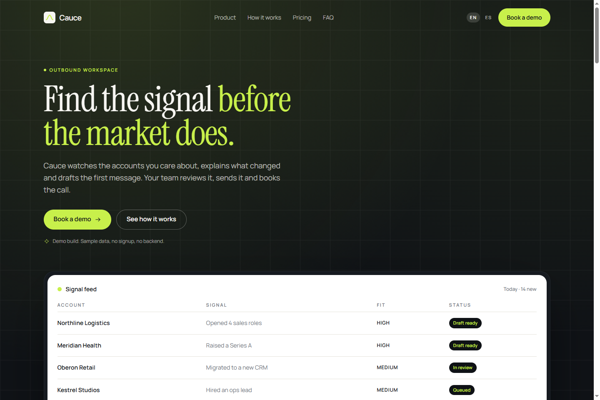

# Cauce

Bilingual landing page for a fictional outbound workspace for B2B teams, built with Next.js 16, TypeScript and Tailwind CSS v4.



## What it is

A single-page marketing site for Cauce, a product that watches a sales team's accounts, explains what changed and drafts a first message for approval. It ships with two locales, a theme in one file, self-hosted imagery and generated social metadata.

It is a demo, not a product: there is no account system, no billing, no backend and no sending. The signal table, pricing and metrics are hand-written sample content, and the metrics section says so on the page.

## Why this over a SaaS landing template

- **Two real locales.** English and Spanish routes under `app/[locale]`, with browser detection, a remembered cookie and `hreflang` alternates — not a language toggle that only swaps a headline.
- **One theme file.** Every colour and radius lives in `app/globals.css` as a Tailwind v4 token. No hex values in components, so a rebrand is a single edit.
- **Copy outside the markup.** All strings live in `i18n/dictionaries/en.ts` and `es.ts`, typed by one `Dictionary` type, so a missing translation fails the build.
- **No remote media.** Both section images, the icon and every social icon are self-hosted or drawn as inline SVG. Fonts are bundled at build time through `next/font`.
- **Honest content.** The FAQ states that this is a demo, the metrics are labelled as sample data, and no customer logos or invented case studies are used.
- **Small dependency surface.** React, Next.js, Tailwind, `framer-motion` for the section entrances, and `clsx`/`tailwind-merge`. No UI kit.

## Quick start

Requirements: Node 24 and pnpm 11.

```bash
git clone https://github.com/JORDANROBERTO74/cauce.git
cd cauce
pnpm install
pnpm dev
```

Open <http://localhost:3000>; the proxy redirects to `/en` or `/es` based on `Accept-Language`.

| Command | What it does |
| --- | --- |
| `pnpm dev` | Start the development server |
| `pnpm build` | Create an optimized production build |
| `pnpm start` | Serve the production build |
| `pnpm lint` | Run ESLint |
| `pnpm typecheck` | Run `tsc --noEmit` |

## Internationalisation

`i18n/config.ts` lists the locales, the default and the cookie name. `i18n/get-dictionary.ts` is the only place that maps a locale to its dictionary, and `i18n/dictionaries/en.ts` owns the `Dictionary` type, so Spanish cannot drift out of shape.

The root `proxy.ts` reads the cookie first, then `Accept-Language`, and redirects `/` to the matching locale. `components/layout/locale-switcher.tsx` stores the explicit choice in the same cookie. Prices are formatted per locale with `Intl.NumberFormat` from `lib/format.ts`, using the currency in `config/region.ts`.

To add a locale: add it to `locales`, create the dictionary, and add the tag to `localeTags` in `lib/format.ts`.

## Content and sections

Sections render in this order from `app/[locale]/page.tsx`: hero, features, four-step process, integrations, metrics, pricing, FAQ, closing call to action. The header and footer are in `components/layout` and `components/sections`.

Every section receives its slice of the dictionary as a prop; nothing reads the locale from context. To change copy, edit the two dictionaries. To change structure, edit the component: the process tabs and the FAQ accordion keep their state and semantics locally.

## SEO

`generateMetadata` in `app/[locale]/layout.tsx` builds title, description, canonical, `hreflang` and Open Graph per locale. `lib/seo.ts` derives absolute URLs from `NEXT_PUBLIC_SITE_URL`. `app/sitemap.ts` and `app/robots.ts` read the same helper, and `app/[locale]/opengraph-image.tsx` renders a 1200×630 image at request time with no external assets.

## Project structure

```text
app/
  [locale]/
    layout.tsx           fonts, metadata, header/footer, JSON-LD
    page.tsx             section order
    not-found.tsx        404 in the default locale
    opengraph-image.tsx  generated social card
  globals.css            theme tokens and base styles
  icon.svg               brand mark
  robots.ts, sitemap.ts
components/
  motion/reveal.tsx      entrance animation wrapper
  sections/              hero, features, steps, integrations, metrics, pricing, faq, cta, footer
  layout/                header, locale switcher
  ui/button.tsx          link and button styles via cva
  icons.tsx              inline SVG icon set and logo
config/                  site identity, region and currency
i18n/                    locales, loader, dictionaries
lib/                     seo helpers, currency formatting, cn
proxy.ts                 locale detection and redirect
```

## Deployment

The site is deployed on Vercel as a static build of the two locale routes.

1. Import the repository in Vercel; the framework preset is detected.
2. Set `NEXT_PUBLIC_SITE_URL` to the production origin. It drives canonical URLs, `sitemap.xml`, `robots.txt` and the Open Graph URLs.
3. Deploy. No other environment variables are required.

Live demo: <https://cauce.vercel.app>

## Status and scope

Verified in this build: `pnpm typecheck`, `pnpm lint`, `pnpm build`, and a headless pass of `/en` and `/es` at 390px and 1440px with no requests to any third-party host.

Out of scope: accounts, authentication, payments, email sending, analytics beyond Vercel Analytics, and a CMS. The metrics, pricing and accounts in the signal table are sample data.

## License

Proprietary, all rights reserved. See [LICENSE](LICENSE).
